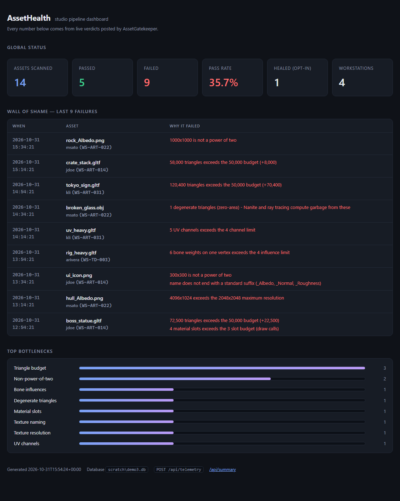
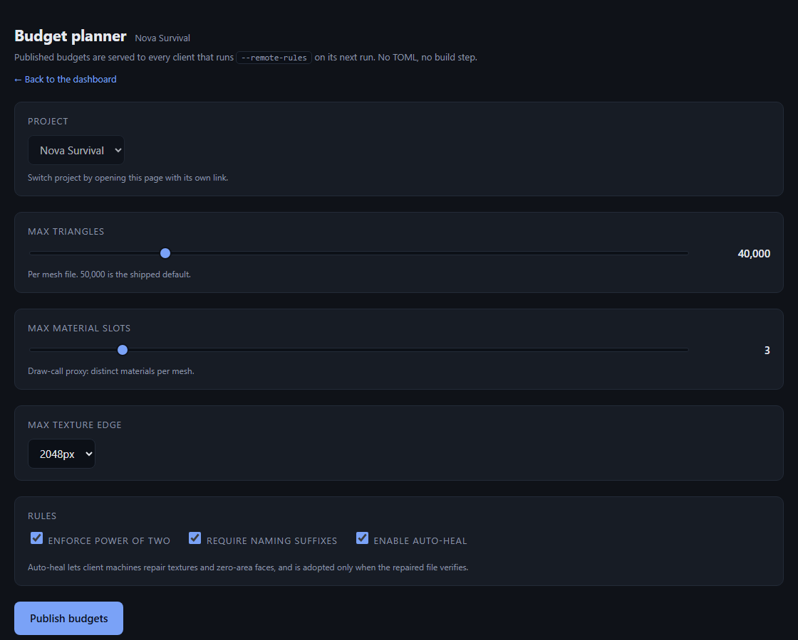
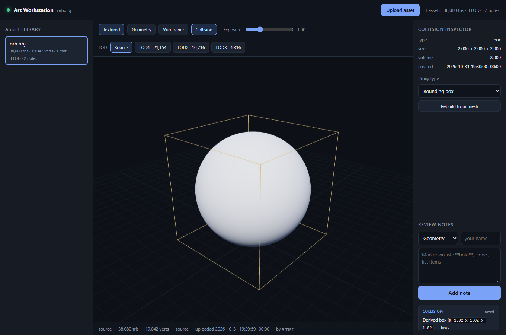

<div align="center">

# AssetGatekeeper

**A budget gate for the moment an asset leaves the DCC — not three days later in a build review.**

[](https://www.python.org/)
[](https://pypi.org/)
[](#testing)
[](#license)
[](#contributing)

*One file. Three dependencies. Zero excuses for a 214k-triangle hero asset.*

**Docs:** [Quickstart](QUICKSTART.md) (5 minutes) &middot; [Manual](MANUAL.md)
(every flag, every config key, solo vs team workflows)

</div>

---

## The problem: pipeline whack-a-mole

Somebody exports a hero prop. It looks gorgeous in the viewport. It is also **214,000 triangles**, has **seven material slots**, and its albedo is **8192×8192** because the sculpt was three times scale.

You find out three days later. The build is at 40 FPS, the texture pool is over budget, and the artist has already moved on to the next sprint. The fix is a four-hour round trip through the sculpt, the retopo, the bake, and a re-export — and it happens *again* next week, because nothing in the pipeline ever told anyone at the moment of the mistake.

Perforce and Git do not catch this. They store pixels and vertices; they have no opinion about them. Review catches it late, if at all. What's missing is a gate at the **exact moment the file lands on disk** — while the artist still has the file open and the export preset on screen.

That is the entire job of AssetGatekeeper: watch one folder, inspect every export the instant it arrives, and say **`PASSED`** or **`FAILED: <reason>`** on one terminal line.

```
14:22:31 rules   D:\Exports\rules.toml
14:22:31 budget  tris<=50,000  texture<=2048px  pot=on  materials<=3  naming=on
14:22:34 FAILED: 214,301 triangles exceeds the 50,000 budget (+164,301); 7 material slots exceeds the 3 slot budget (draw calls)  hero_prop.gltf 214,301 tris / 7 mat
14:22:41 FAILED: 8192x8192 exceeds the 2048x2048 maximum resolution; name does not end with a standard suffix (_Albedo, _Normal, _Roughness)  hero_prop_diffuse.png 8192x8192
14:23:02 PASSED  crate_A_albedo.png 1024x1024
```

Two problems, one line, told to the artist *while they still have the export dialog open*. That's the difference between a five-second fix and a five-day defect.

---

## What it checks

| Asset | Rule | Default | Why it matters |
| :--- | :--- | :--- | :--- |
| `.obj` `.gltf` `.glb` | Triangles | `50,000` | The classic budget overrun; also catches empty/truncated exports at `0` tris |
| `.obj` `.gltf` `.glb` | Material slots | `3` | A draw-call proxy — 12 materials on one prop is 12 draw calls before it's even instanced |
| `.png` | Max edge | `2,048 px` | VRAM and streaming pressure; 8192² is 64× the memory of 1024² |
| `.png` | Power of two | on | Every mip-chain, every compressed texture format, every "why is this blurry" bug report |
| `.png` | Naming suffix | `_Albedo` `_Normal` `_Roughness` | Assets named `final_final_diffuse_v2.png` are the ones that never get replaced |
| `.gltf` `.glb` | Bone influences per vertex | `4` | Above four weights a vertex is undefined behaviour on mobile and web runtimes |
| `.obj` `.gltf` `.glb` | UV channels | `4` | Extra TEXCOORD sets cost memory in every shader permutation; engines cap at 4–8 |
| `.obj` `.gltf` `.glb` | Degenerate triangles | `0` | Zero-area faces poison Nanite clusters and ray-tracing BVHs, invisibly |

Everything is configurable per folder with a `rules.toml`, and every rule can be overridden or disabled from the command line.

---

## Install

Two ways in. The dependency line is worth stating plainly, because it is the
question everyone asks first:

| Part | Needs |
| :--- | :--- |
| **The gate** (`asset_gatekeeper.py`) | `trimesh` + `pillow` — the texture lookups and deep mesh profiling cannot be done without them, and a gate that silently skipped half its rules would be worse than one that refuses to start |
| **The watch loop** | `watchdog`, or nothing at all: it falls back to polling |
| **Healer, LOD engine, AssetHealth, Art Workstation** | standard library only |
| **The viewer** | Three.js, from a CDN |

```bash
# 1. as a package (recommended: gives you the `asset-gatekeeper` command)
pip install "asset-gatekeeper[full]"       # or: pip install .[full] from a checkout
```

```bash
# 2. as a single file, no install at all
curl -O https://raw.githubusercontent.com/ohio13/asset-gatekeeper/main/asset_gatekeeper.py
python asset_gatekeeper.py --help
```

**Requirements:** Python 3.11+ (uses the standard-library `tomllib`). Python 3.9–3.10 works if you `pip install tomli`, or if you provide rules as JSON.

### First run: the setup wizard

```bash
asset-gatekeeper --init
# AssetGatekeeper setup
# Folder to watch [C:\pipeline\assets]:
# Triangle budget per mesh [50000]:
# Material slots per mesh [3]:
# Max texture edge (512/1024/2048/4096) [2048]:
# Default platform profile (none/mobile/console/pc) [none]:
# Enable auto-healing (off is safer) [y/N]:
#
#   folder   C:\pipeline\assets
#   rules    C:\pipeline\assets\rules.toml
#   budget   tris<=50,000  texture<=2048px  materials<=3
#
# Next:
#   asset-gatekeeper "C:\pipeline\assets" --once          # one sweep
#   asset-gatekeeper "C:\pipeline\assets"                 # watch it live
```

`--init` writes a `rules.toml` with your answers, the three platform profiles, and
healing explicitly off. `--yes` takes every default (safe for scripts), `--force`
overwrites an existing file, and a prompt that hits EOF falls back to its default
instead of hanging a CI job.

---

## Use it — for artists

Point it at the folder your DCC exports into and leave it running in a terminal tab:

```bash
python asset_gatekeeper.py "D:\Exports\Incoming"
```

```
14:22:31 watching D:\Exports\Incoming - Ctrl+C to stop
14:22:31 budget  tris<=50,000  texture<=2048px  pot=on  materials<=3  naming=on
14:23:02 FAILED: name does not end with a standard suffix (_Albedo, _Normal, _Roughness)  hero_prop_diffuse.png 4096x4096
14:23:19 PASSED  rock_cliff_Albedo.png 2048x2048
14:24:55 PASSED  crate_01.glb 8,411 tris / 2 mat
```

Drop a file in, get a verdict. That's it. Colour-coded on a real terminal, plain text when redirected. Files that are still being written are ignored until they settle, so a Blender export in progress never produces a false failure.

---

## Use it — for build engineers

`--once` sweeps a folder, prints one line per asset, prints a summary, and **exits non-zero if anything failed**. That single design decision is what makes it usable in automation.

```bash
python asset_gatekeeper.py Assets/Exports --once --recursive
```

```
14:31:02 842 asset(s): 837 passed, 5 failed
$ echo $?
1
```

### Pre-commit hook

`.git/hooks/pre-commit`:

```sh
#!/bin/sh
python tools/asset_gatekeeper.py Assets/Exports --once --recursive
status=$?
if [ $status -ne 0 ]; then
    echo ""
    echo "Blocked: the assets listed above exceed the project budget."
    echo "Fix them, or relax the rule in Assets/Exports/rules.toml if the gate is wrong."
fi
exit $status
```

### CI

```yaml
- name: Asset budget gate
  run: |
    python -m pip install watchdog trimesh pillow
    python tools/asset_gatekeeper.py Assets/Exports --once --recursive
```

### Exit codes

| Code | Meaning |
| :--- | :--- |
| `0` | Every inspected asset passed (or folder was empty) |
| `1` | At least one asset failed a budget rule |
| `2` | Setup problem — bad folder, missing dependency, or an invalid `rules.toml` |

---

## Configuration: `rules.toml`

Drop a `rules.toml` in the folder you're watching and it becomes the project's budget. Every key is optional; anything you leave out keeps the shipped default, so a studio file only states what is different.

```toml
# rules.toml — lives next to the assets it governs.
#
# Precedence:  explicit CLI flag  >  remote rules  >  this file  >  built-in defaults

[mesh]
max_triangles = 50000        # hard cap per mesh file
max_material_slots = 3       # draw-call proxy; distinct materials per mesh
max_bone_influences = 4      # per-vertex weights (mobile/web GPU limit)
max_uv_channels = 4          # TEXCOORD_n sets
allow_degenerate = false     # zero-area triangles break Nanite and ray tracing
degenerate_epsilon = 1e-08   # area below which a triangle counts as degenerate

[texture]
max_edge = 2048              # longest edge, in pixels
power_of_two = true          # reject 1000x560, accept 512x256
naming = true                # require a standard map suffix
suffixes = ["_Albedo", "_Normal", "_Roughness"]   # case-insensitive, allows _Albedo_02
```

A copy ships as [`asset_gatekeeper.example.toml`](asset_gatekeeper.example.toml).

**Why flags still win.** CI must be able to tighten one number without editing a file that artists own and submit to source control:

```bash
# artists get 50k from rules.toml; the ship build gets 25k, everything else unchanged
python asset_gatekeeper.py Assets/Exports --once --triangles 25000
```

```
14:40:11 rules   Assets\Exports\rules.toml
14:40:11 cli     overriding max_triangles
14:40:11 budget  tris<=25,000  texture<=2048px  pot=on  materials<=3  naming=on
```

Load a shared file explicitly with `--rules path/to/rules.toml`. On Python < 3.11 without `tomli`, the same structure is accepted as JSON:

```json
{ "mesh": { "max_triangles": 50000 }, "texture": { "naming": false } }
```

**Typos fail loudly, not silently.** A misspelled key (`max_triange`) or a bad type stops the run with exit code `2` instead of quietly enforcing the default — a silent typo in a budget file is worse than a crash, because the gate *looks* like it's working.

```
14:41:07 invalid rules file: Assets\Exports\rules.toml: unknown key(s) in [mesh]: max_triange
```

Files saved by Notepad or PowerShell carry a UTF-8 BOM; those load fine.

---

## Auditing depth: references, platforms, PBR and pivots

Four checks that catch what a triangle count cannot.

### 1. Broken references and orphans

A `.gltf` pointing at a texture nobody shipped is broken everywhere, so this is
**on by default**. The gate follows `buffers[].uri` and `images[].uri` in glTF,
and `mtllib` plus the `map_*` lines inside those `.mtl` files in OBJ. Data URIs and
`http(s)` URLs are ignored — they are not files to resolve.

```
FAILED: missing reference 'wood_Albedo.png' (broken link: the engine cannot load it)   table.gltf
```

Orphans are the other half, and they are repository-level: a texture in the folder
that no mesh points at. They are a report, not a per-asset verdict:

```bash
python asset_gatekeeper.py D:\Exports --audit
# BROKEN  props/table.gltf
#           -> wood_Albedo.png   (expected D:\Exports\props\wood_Albedo.png)
# ORPHAN  props/old_wood_Albedo.png
# 41 mesh file(s), 96 reference(s), 1 broken, 1 orphaned texture(s)     # exit 1
```

`--no-reference-check` turns the per-asset failure off; `--audit` is unaffected.

### 2. Platform profiles

```toml
platform = "pc"          # optional default

[platforms.mobile]
max_triangles = 15000
max_material_slots = 2
max_texture_edge = 1024

[platforms.console]
max_triangles = 250000
max_texture_edge = 4096
```

```bash
python asset_gatekeeper.py D:\Exports --once --platform mobile
# budget  tris<=15,000  texture<=1024px  ...  platform=mobile
```

Precedence is unchanged in shape: **CLI flag > `[platforms.<name>]` > flat
`[mesh]`/`[texture]` values > defaults**. A profile may only override budget keys —
`PLATFORM_KEYS` is a whitelist, so a profile cannot switch auditing off for one
platform. An unknown profile name is a config error (exit 2), not a silent fallback.

### 3. PBR value sanitisation

Albedo is a *reflectance colour*, not a painting: real surfaces live in a narrow
band, pure black absorbs everything, pure white blinds the lighting model.
`_Albedo` and `_Diffuse` textures are sampled at 64×64 and measured by mean Rec. 709
luminance (and by how much of the image is clipped to the extremes):

```
FAILED: albedo mean luminance 0.000 is below the PBR floor 0.02 (near-black absorbs all light)
FAILED: albedo mean luminance 1.000 is above the PBR ceiling 0.94 (near-white blinds the lighting model)
```

Normal and roughness maps are never checked — a flat violet normal map is correct,
and a pure-white roughness map is correct. Thresholds live in `[texture]`
(`pbr_floor`, `pbr_ceiling`, `pbr_suffixes`) and `--no-pbr-check` disables it.

### 4. Geometric boundary profiling

Opt-in (`[mesh] audit_transforms`, `--audit-transforms`, `--require-indexed`) —
an offset pivot is frequently authored on purpose, so this is a review prompt
rather than a rule violation:

| Finding | Test |
| :--- | :--- |
| **Unbaked translation** | node `translation` (or `matrix[12:15]`) further from the origin than `transform_epsilon` |
| **Unbaked rotation** | node `rotation` quaternion with `|w| ≠ 1` beyond 1e-3 |
| **Uncentred pivot** | geometry's own bbox centre further than `pivot_tolerance` × its diagonal from its origin |
| **Unindexed geometry** | glTF primitive with no `indices`; for OBJ, more than 0.95 vertices per corner (triangle soup) |

```
FAILED: 'probe' has an unbaked translation (3.000, 0.000, 0.000); the pivot is floating, so engine placement will double the offset
FAILED: geometry is centred 10.012m from its own origin (50% of its size); the pivot is uncentred
```

`--require-indexed` implies `--audit-transforms`: asking for one audit without the
other would silently skip the pivot checks that make it useful.

---

## Per-asset budgets: tags and presets

One folder can hold a 1,500-triangle prop and a 120,000-triangle boss. Flat limits
force the whole project to the loosest one, so budgets can be **tagged**:

```toml
[mesh]
max_triangles = 50000

[tags.Monsters_Boss]
max_triangles = 1000        # bosses get a bigger budget... or a stricter one

[tags.Props]
max_triangles = 5000
texture = { pbr_floor = 0.05 }   # a tag may tighten a threshold too

[tagging]
mode = "suggest"            # auto | suggest | strict
min_similarity = 0.75
```

The tag comes from the **folder** (`Exports/Monsters_Boss/…`) or the **filename
prefix** (`Props_01.gltf`), case and separators ignored. Shipped **presets**
(`--preset retro|mobile|pc`) are the same mechanism with the values living in code,
so a project file cannot quietly degrade them.

**Near misses are not dropped.** `Monsters_Bos/` is fuzzy-matched to
`Monsters_Boss` (difflib, threshold configurable) and *never* silently falls back
to the global budget — that fallback is the exact failure this feature exists to
prevent. Modes:

| `tagging.mode` | Behaviour |
| :--- | :--- |
| `auto` | accept the closest tag, log it |
| `suggest` (default) | accept it **and** print `note: tag 'Monsters_Bos' … closest match is 'Monsters_Boss'` |
| `strict` | refuse the guess: fail with "rename the folder to match" |

## Native desktop toasts

On by default **while watching** a folder, off for `--once`, single-file mode and
CI — a build agent has nobody to interrupt. `--notify` / `--no-notify` force it
either way. Windows uses a WinRT toast with a tray-balloon fallback, Linux uses
`notify-send` (or `zenity`), macOS `osascript`. Rate-limited to 6/min, queued on a
daemon thread, and text travels through environment variables rather than being
interpolated into a PowerShell string — asset names are artist-controlled input.

## Auto-healing: opt-in, and verified before it touches your file

The gate **fails and locks by default.** It never modifies an artist's asset on its
own — automated resampling changes detail, mesh decimation destroys intent, and a
tool that silently rewrites files during a submit is indistinguishable from
corruption. Healing is a deliberate act:

```bash
python asset_gatekeeper.py D:\Exports --auto-heal      # or [healer] enabled = true
```

What it will repair, and what it refuses to:

| Problem | Healed? | How |
| :--- | :--- | :--- |
| `.png` not a power of two | yes | pad to the next POT (edge replication) or LANCZOS resize — `[healer] texture_mode` |
| `.png` missing a naming suffix | yes | rename with the inferred suffix (`_Albedo`/`_Normal`/`_Roughness`) |
| `.obj` zero-area faces | yes | delete the degenerate faces, rewrite the file |
| Triangle budget exceeded | **no** | decimation is not a safe transformation |
| Texture resolution exceeded | **no** | that would throw away detail the artist chose |
| Material slots, UV channels, bone weights | **no** | needs an artist decision, not a script |
| `.gltf` / `.glb` geometry | **no** | rewriting accessors and buffers blind corrupts files |

**Nothing is adopted unless it verifies.** The healer copies the asset into a
staging folder inside the same directory, repairs the copy, runs the *same* budget
over it, and only then swaps it in atomically. If the healed copy still fails —
say a 4096×1000 texture that pads to 4096×1024 and still blows the edge limit —
the staged copy is deleted and the original is left byte-for-byte intact. It also
refuses to rename onto a file that already exists, and it never recurses on its
own staging folder.

```
15:41:07 PASSED WITH HEALING: padded 1000x1000 -> 1024x1024  stone_Albedo.png 1024x1024
15:41:07 PASSED WITH HEALING: Stripped 1 degenerate face     broken_glass.obj 12 tris / 1 mat
15:41:07 FAILED: 4096x1024 exceeds the 2048x2048 maximum resolution  huge_Albedo.png   (unhealable: bytes untouched)
```

```toml
[healer]
enabled = false        # the only safe default
textures = true        # NPOT + suffix renames
meshes = true          # zero-area .obj faces
texture_mode = "pad"   # "pad" preserves every pixel; "resize" resamples
```

`--no-auto-heal` exists so CI and the VCS hooks can pin healing **off** even when a
project file turns it on. A heal is reported to AssetHealth as `status: "HEALED"`
with the list of modifications, so a studio can still see every file that was
rewritten on the way in.

---

## Version control hooks: reject at the door

`vcs_hooks/` holds the gateway code for build engineers who want the failure to
happen *before* a bad asset enters the depot. All three hooks pass
`--no-auto-heal`: a hook that rewrites an artist's file mid-submit is not a gate.

| Hook | Installed as | Mechanism |
| :--- | :--- | :--- |
| `p4_pre_submit.py` | a `change-submit` trigger | `p4 describe` → `p4 print` each rev to a temp tree → gate → reject |
| `git_pre_commit.py` | `.git/hooks/pre-commit` (`--install`) | `git diff --cached` → gate the staged assets |
| `git_pre_push.sh` | `.git/hooks/pre-push` | upstream-or-empty-tree diff → gate → block the push |

```python
# Perforce server trigger (p4 triggers), tabs between fields:
AssetGatekeeper change-submit //depot/.../..."python C:\p4\hooks\p4_pre_submit.py %changelist% %user%"
```

```
$ git commit
Commit blocked by AssetGatekeeper:
  - crate_4mtl.obj [LFS]
    15:41:07 FAILED: 4 material slots exceeds the 3 slot budget (draw calls)  crate_4mtl.obj 4,000 tris / 4 mat

Nothing was healed or modified. Commit the fix, or `git commit --no-verify` if a
technical lead agrees.
```

Both git hooks refuse to run on an interpreter older than 3.9 rather than dying on
a syntax error, fail closed if `p4 describe` cannot be read, and honour
`AGK_GATEKEEPER` / `AGK_PYTHON` for non-standard installs.

---

## Enterprise: central rules and telemetry

Two optional integrations for teams running this behind a studio platform. Both
are standard library only (`urllib`, `json`, `threading`) — the dependency-free
profile is intact, and with neither switched on the tool behaves exactly as before.

```toml
# rules.toml — [server] is optional
[server]
url = "https://studio.example/api/verdicts"          # telemetry sink
remote_rules_url = "https://studio.example/rules.json"  # central budget
# token = "..."       # prefer ASSET_GATEKEEPER_TOKEN over committing this
```

| Knob | CLI | Environment | `rules.toml` |
| :--- | :--- | :--- | :--- |
| Telemetry sink | `--telemetry-url URL` | `ASSET_GATEKEEPER_SERVER_URL` | `[server] url` |
| Central budget | `--remote-rules URL` | `ASSET_GATEKEEPER_REMOTE_RULES` | `[server] remote_rules_url` |
| Shared token | — | `ASSET_GATEKEEPER_TOKEN` | `[server] token` |

### Remote rules with an offline cache

```bash
python asset_gatekeeper.py "D:\Exports" --remote-rules https://studio.example/rules.json
```

The endpoint returns the same document as `rules.toml`, as JSON (any Python) or
TOML (3.11+). Precedence becomes **CLI flag > remote rules > `rules.toml` > defaults**,
so central policy overrides an artist-owned file while CI can still tighten one
value for a ship build.

A successful fetch is cached to `.rules.cache.json` in the watch folder. If the
network is down, slow, or returns something unparseable, the tool loads the cached
profile, prints one warning, and keeps working:

```
14:22:31 Central server offline; using cached rules profile (.rules.cache.json)
14:22:31 rules   https://studio.example/rules.json (remote, cached as .rules.cache.json)
14:22:31 budget  tris<=20  texture<=2048px  pot=on  materials<=1  ...
```

A malformed payload can never poison the cache: the new document is validated
tightly *before* it is written, and the previous good copy survives. With no cache
at all, the run degrades to the local `rules.toml` and then to the shipped defaults.

### Verdict telemetry

Every verdict is POSTed as one flat JSON object, so a warehouse can ingest it
without bespoke parsing:

```json
{
  "schema": 1,
  "timestamp": "2026-10-31T15:23:28+00:00",
  "hostname": "WS-ART-014", "username": "jdoe",
  "platform": "Windows-11-10.0.26100-SP0", "python": "3.11.0",
  "name": "boss_statue.gltf", "path": "props/boss_statue.gltf", "size_bytes": 1160991,
  "passed": false, "metric": "72,500 tris / 4 mat",
  "stats": {"triangles": 72500, "material_slots": 4, "degenerate_triangles": 0},
  "problems": ["72,500 triangles exceeds the 50,000 budget (+22,500)",
               "4 material slots exceeds the 3 slot budget (draw calls)"]
}
```

`path` is **relative to the watch folder**, never the artist's absolute layout.
A token, when configured, is sent as `Authorization: Bearer <token>`.

**The network cannot slow the gate.** Three separate guards, because this is the
one feature that could ruin a studio's day:

| Guard | What it prevents |
| :--- | :--- |
| `submit()` only enqueues; one daemon thread owns the sockets | A slow endpoint delaying a verdict, ever |
| `urlopen(..., timeout=2.0)` on every request | A hung TCP connection parking the worker forever |
| Capped queue (1,000) that drops and counts | An overnight 200k-file sweep growing memory without bound |

Failures are silent by contract: `-v` turns them into `telemetry: POST failed
(TimeoutError): timed out`, and `telemetry: 2 sent, 0 failed, 0 dropped` appears at
shutdown. Nothing is retried — a gate that spools failed telemetry to disk is a
gate that will eventually fill an artist's drive.

> **Costs worth knowing:** shutdown flushes the queue with at most one 2 s wait,
> and an unreachable `--remote-rules` endpoint adds up to 2 s to startup. Both are
> once per run, never per asset. Telemetry over plain `http://` is allowed but
> warned about, since asset names and paths travel in clear text.

---

## AssetHealth: the receiving dashboard

`server/asset_health_server.py` is the studio end of the pipe: one file,
`http.server` + `sqlite3` + `json`, no framework, no ORM, no JS build step. Point
the gate at it and it becomes the answer to "which rules are actually costing us?"

```bash
python server/asset_health_server.py --port 8080
# then, in each artist's terminal or CI job:
python asset_gatekeeper.py "D:\Exports" --once --telemetry-url http://studio:8080/api/telemetry
```



| Route | Method | Returns |
| :--- | :--- | :--- |
| `/api/telemetry` | `POST` | Stores one verdict + its problems, `201 {"stored": true, "id": 41}` |
| `/dashboard` | `GET` | The HTML page above (`?project_id=N` to scope) |
| `/budget-planner` | `GET` | Visual budget editor for producers (`?project_id=N`) |
| `/api/save-budget` | `POST` | Publishes a project's budget |
| `/api/rules` | `GET` | The published budget as a `rules.toml`-shaped document, for `--remote-rules` |
| `/api/summary` | `GET` | The same totals and ranking as JSON, for a wallboard or a test |
| `/` | `GET` | `302` → `/dashboard` |

### Multi-project isolation

One server, many projects — first-party teams and outsource vendors — with no
shared rows. Create a project on the server:

```bash
python server/asset_health_server.py --db studio.db --add-project "Nova Survival"
# created project 1: Nova Survival
#   token      GuQwhkXMSlRBI7dG_-nkJNRJLw09IMQW   (shown once; only its hash is stored)
#   dashboard  /dashboard?project_id=1&token=<token>
#   rules URL  /api/rules?project_id=1  (for --remote-rules)
```

The token becomes the artist's `ASSET_GATEKEEPER_TOKEN`, so the same variable
authenticates both telemetry and the remote-rules fetch:

```bash
export ASSET_GATEKEEPER_TOKEN=<token>
python asset_gatekeeper.py D:\Exports --once \
    --remote-rules https://studio/api/rules?project_id=1 \
    --telemetry-url  https://studio/api/telemetry
```

| Credential | Can do |
| :--- | :--- |
| **Project token** | POST verdicts into its own project; read *only* its own dashboard, summary and rules |
| **Admin token** (`AUTH_TOKEN` / `--token`) | See every project, pick one with `?project_id=`, publish budgets for any project |
| **No token, no projects** | Legacy single-tenant mode — unchanged behaviour for existing installs |

Guarantees, all covered by tests: a project token asking for another project is a
**403**, not a silent fallback; a `project_id` in the POST body cannot redirect a
token's write (**tested**); tokens are stored as `sha256:<hex>` and compared with
`hmac.compare_digest`; the refusal page never lists the other tenants.

### Webhook alerts

```bash
export SLACK_WEBHOOK_URL=https://hooks.slack.com/services/...
python server/asset_health_server.py --port 8080     # or --webhook-url / --webhooks-config
```

A failure alerts only when it is **more than 50% over** a budget — 80,000 triangles
on a 50,000 budget alerts, 60,000 does not. Healed assets and plain passes never
alert; the point is to page someone about a real regression, not every red line.

```
🔴 CRITICAL PIPELINE ALERT: User alice on WS-ART-014 failed validation for
boss_statue.gltf. Reasons: 72,500 triangles exceeds the 50,000 budget (+22,500).
Over budget: triangles 72,500 vs 50,000 (1.8x)
```

The envelope adapts to the provider (`text` for Slack, `content` for Discord, a
`MessageCard` for Teams), and the URL's provider is inferred when
`--webhook-provider` is not given. Delivery uses the same three rules as the
telemetry sender: a queue, one daemon thread, a 2 s timeout, drop-and-count —
**a dead webhook can never fail an ingest**.

**Throttled per project.** A nightly sweep that fails 300 assets is one incident,
not 300 notifications: the server sends at most one message per project per
cooldown window (default 300 s, `--alert-cooldown` or `[webhooks] cooldown`; `0`
disables it). The claim is a single atomic upsert, so two workers failing the same
batch at the same instant cannot both alert:

```sql
INSERT INTO alerts_state (scope_key, last_alert_at) VALUES (?, ?)
ON CONFLICT(scope_key) DO UPDATE SET last_alert_at = excluded.last_alert_at
WHERE alerts_state.last_alert_at <= ?          -- out of the cooldown window only
```

Suppressed alerts are counted and reported in `/api/summary`, so a lead can tell
"the pipeline is quiet" from "someone muted the channel". Nothing is lost: every
verdict is still stored, and the dashboard remains the complete record.

### Budget planner



A producer opens the planner, drags two sliders, picks a texture edge, ticks three
boxes, and clicks **Publish budgets**. That writes the `budgets` table; `/api/rules`
serves it in `rules.toml` shape, so every artist's next `--remote-rules` run picks
it up — no TOML, no commit, no build step.

Ticking **Enable auto-heal** is the interesting one: it reaches clients as
`[healer] enabled = true` in the remote document, so healing can be switched on for
a project centrally. It is still opt-in per run (`--no-auto-heal` beats it), and
the client still only adopts a repair that verifies.

> **Limits worth knowing:** the browser cannot send an `Authorization` header on a
> typed URL, so the dashboard and planner accept `?token=` — that token lands in
> access logs and browser history, so front the server with a reverse proxy that
> injects the header and strips the query. Tokens are per project, not per user, so
> an offboarded artist's token must be rotated manually. The alert cooldown is per
> project and wall-clock only: a genuinely new incident inside the window is folded
> into the same message window, which is the tradeoff that keeps channels readable.

### Auth

Set `AUTH_TOKEN` (or pass `--token`) and every request needs
`Authorization: Bearer <token>`; anything else is a `401` before the database is
touched. The comparison is constant-time, and the server binds to `127.0.0.1` by
default — reaching it from the network is a deliberate `--host 0.0.0.0`, which the
boot log calls out when no token is set.

### What it stores

```sql
verdicts(id, timestamp, received_at, hostname, username, os,
         filename, filepath, filesize, passed, metric)
problems(id, verdict_id REFERENCES verdicts(id) ON DELETE CASCADE, message)
meta(key, value)          -- 'seeded' marker
```

One row per asset, one row per problem, joined by `verdict_id` — which is why the
`Verdict` tuple of problems exists in the first place. `PRAGMA foreign_keys=ON` is
set per connection so deleting a verdict takes its problems with it, and WAL mode
keeps the dashboard readable while verdicts are landing.

### The three numbers

- **Global status** — total scanned, passed, failed, pass rate, distinct workstations.
- **Wall of shame** — the last 20 failures, newest first, each with *every* reason it
  broke, plus who and which machine.
- **Top bottlenecks** — every problem string is bucketed into the rule a lead thinks
  in (`Triangle budget`, `Non-power-of-two`, `Bone influences`, …) and ranked. Unknown
  text is counted, never dropped, under `Other`.

### Demo data on first launch

A brand-new database is seeded with 13 fake verdicts across four workstations and
six rules, so the page is layout-complete the first time you open it. It happens
exactly once — a `meta.seeded` marker makes reseeding impossible even if you delete
rows. Use `--no-seed` for a clean deployment.

> **Limits worth knowing:** `timestamp` is the client's clock (`received_at` is the
> server's, if you doubt a workstation); bottlenecks reads the `problems` table and
> buckets in Python, which is fine to ~100k rows and wants a `GROUP BY` after that;
> there is no pagination, no retention policy, and no TLS — put it behind your
> reverse proxy, and treat the shared token as shared, not per-user.

---

## DCC integrations

Same rules, four front doors — the verdict arrives where the artist actually works.

| Host | Path | Feedback | Can it block? |
| :--- | :--- | :--- | :--- |
| **Blender** | `plugins/blender/addon.py` | Viewport sidebar panel, problems in red | Pre-export check |
| **Maya** | `plugins/maya/gatekeeper_maya.py` | Shelf button, dialog, Script Editor | In-scene, before export |
| **Houdini** | `plugins/houdini/sop_gatekeeper.py` | Node warning badge on every cook | Non-fatal (never breaks a cook) |
| **Unreal** | `plugins/unreal/init_unreal.py` | Message Log + dialog after import | Yes for scripted imports; warn-only for drag-and-drop |

Every plugin reads the budget through the engine's own parser, so a rule can never
mean different things in different applications. Install steps live in
[plugins/README.md](plugins/README.md).

All four speak one contract, and that contract is just the CLI:

```bash
python asset_gatekeeper.py path/to/asset.gltf --json
# {"file": "...", "name": "asset.gltf", "passed": false,
#  "metric": "214,301 tris / 7 mat", "problems": ["214,301 triangles exceeds ..."]}
```

> **Verified vs. untested:** the plugin files are syntax-checked and written with
> capability probing + fallbacks, but **no DCC was installed on the machine this was
> built on**, so none of them has been run inside its host yet. The `--json` contract
> they depend on *is* covered by the test suite.

---

## Architecture

Four layers, one responsibility each. Data flows one way, and nothing that touches the disk is decided by the layer that formats output.

```
   artist export
        │
        ▼
┌────────────────┐   watchdog: created / modified / moved
│    WATCHER     │   filters by extension, drops .tmp / ~$ / .part scratch files
└───────┬────────┘
        │  candidate paths only — never analyses anything on the observer thread
        ▼
┌────────────────┐   queue.Queue, one producer, one worker
│    QUEUE       │   collapses the created+modified pair from a single save
└───────┬────────┘
        ▼
┌────────────────┐   size unchanged for 350 ms and file openable
│   STABILITY    │   (1.5 s grace for zero-byte files, so a slow exporter
│    WINDOW      │    that opens a handle before writing is not misjudged)
└───────┬────────┘
        ▼
┌────────────────┐        ┌──────────────────────┐
│  GATEKEEPER    │◀───────│        BUDGET        │  rules.toml > defaults
│  (pure logic)  │        └──────────────────────┘
└───────┬────────┘   ┌─────────────────────────────────────────┐
        │            │ ANALYZERS: trimesh · Pillow · stdlib json│
        │            └─────────────────────────────────────────┘
        ▼  Verdict(path, problems=(), metric="")
┌────────────────┐
│   REPORTER     │   one line per asset, all violations at once
└────────────────┘   PASSED / FAILED: reason; reason; reason
```

### The watcher never does the work

`watchdog` fires `on_created` the instant a file handle opens — before a single byte is written. Analysing on the observer thread means reading half an OBJ and reporting a nonsense triangle count, or worse, a `PASSED` on an empty file that is about to become a 200k-tri monster. Events therefore only **enqueue a path**; a single worker thread does the waiting and the reading. Because there is exactly one worker, there is no scenario where two threads inspect the same file at once, and a pathological asset can never block the event loop.

### The stability window

The worker polls the file size until it has been unchanged for **350 ms** *and* the file can be opened for reading. Blender, Maya, Substance, and Unreal all write incrementally, so the quiet period is what separates "file exists" from "file is finished". Zero-byte files get a longer 1.5 s grace: they settle fast and are worth failing immediately, but an exporter on a network share may legitimately open first and write later.

Verified against a writer that dribbles bytes for 2.5 seconds — **one** correct verdict, not twenty partial ones.

### One line, every problem

A file usually breaks more than one rule at once. Failing on the first violation means the artist fixes the name, re-exports, and *then* discovers the material count — the exact whack-a-mole this tool exists to delete. So a `Verdict` carries a tuple of reasons:

```python
@dataclass(frozen=True)
class Verdict:
    path: Path
    problems: tuple[str, ...] = ()
    metric: str = ""

    @property
    def passed(self) -> bool:
        return not self.problems

    @property
    def tag(self) -> str:
        return "PASSED" if self.passed else f"FAILED: {'; '.join(self.problems)}"
```

An empty tuple is the only way to pass. One asset, one line, all the bad news.

### Counting from the source, not from the loaded object graph

The naive material-slot implementation counts material objects in the loaded scene — and over-reports badly, because loaders build a **separate material object per primitive**. A glTF whose five primitives share material index `0` looks like five slots. AssetGatekeeper counts from the file itself: unique `material` indices in the glTF JSON (including binary `.glb`, parsed straight from the container's JSON chunk with `struct`), and unique `usemtl` names in OBJ text.

The same instinct governs triangles. `trimesh` is the fast path, but a `gltf`/`glb` also has a **dependency-free rescue path**: triangle counts are derived from accessor counts and walked through the node graph so instanced meshes count per use. If `trimesh` or one of its optional loaders is missing or chokes on a file, the gate still gives a verdict instead of dying.

### Layering for contributors

| Layer | Knows about | Deliberately doesn't know |
| :--- | :--- | :--- |
| Analyzers | file formats | budgets, logging, folders |
| `Gatekeeper` | budgets + `Verdict` | the filesystem's mood, output formatting |
| `Reporter` | colour, counters | how a verdict was reached |
| Watcher | events, queue, stability | what any of the rules mean |

`Gatekeeper.check(path)` is pure logic: no logging, no watching, no side effects. That is why the test suite can assert on rules without ever starting a watcher.

---

## CLI reference

```
python asset_gatekeeper.py [folder] [options]
```

| Flag | Effect |
| :--- | :--- |
| `folder` | Folder to watch (default: current directory) |
| `--once` | Inspect everything present, print a summary, exit `0`/`1` |
| `--recursive` | Include subfolders |
| `--rules PATH` | Use a specific rules file instead of `<folder>/rules.toml` |
| `--remote-rules URL` | Fetch the budget from a central endpoint, cached offline as `.rules.cache.json` |
| `--telemetry-url URL` | POST every verdict to this endpoint (2 s timeout, never blocks) |
| `--triangles N` | Override the triangle budget |
| `--max-texture EDGE` | Override the max texture edge, in pixels |
| `--max-materials N` | Override the material-slot budget |
| `--max-influences N` | Override the per-vertex bone-weight budget |
| `--max-uvs N` | Override the UV-channel budget |
| `--platform NAME` | Apply the `[platforms.<NAME>]` compression profile |
| `--audit` | Report broken references and orphaned textures for the whole folder, then exit |
| `--no-reference-check` | Do not fail assets whose texture/buffer links are missing |
| `--no-pbr-check` | Do not clamp albedo luminance |
| `--audit-transforms` | Flag unbaked node transforms and uncentred pivots |
| `--require-indexed` | Also fail triangle-soup geometry (implies the transform audit) |
| `--auto-heal` | Repair failing assets in place (opt-in; see above) |
| `--no-auto-heal` | Force healing off, even if `rules.toml` enables it |
| `--allow-degenerate` | Permit zero-area triangles |
| `--json` | One JSON object per file on stdout (the contract the DCC plugins use) |
| `--allow-npot` | Accept non-power-of-two textures |
| `--no-naming` | Accept texture names without a standard suffix |
| `--no-color` | Disable ANSI colour |
| `-v`, `--verbose` | Debug logging (including why a file was skipped) |

---

## Extending: one new rule in three places

1. Add the field to `Budget` (and its default).
2. Add a `_read_*` call plus the argument in `Budget.from_mapping` so `rules.toml` can set it.
3. Append to `problems` in the relevant `Gatekeeper._check_*` method.

```python
@dataclass(frozen=True)
class Budget:
    ...
    max_vertex_count: int = 65_000   # 1. new field

def _check_mesh(self, path: Path) -> Verdict:
    ...
    if vertices > self.budget.max_vertex_count:   # 3. new check
        problems.append(f"{vertices:,} vertices exceeds the {limit:,} budget")
```

No changes are needed in the watcher, the reporter, or the queue. Rules are data; everything else is plumbing.

---

## Testing

Four layers, because unit tests, networks, browser UIs and DCC reality fail
in different ways.
```bash
# 1. rules, config, healing, VCS hooks, presets - 396 assertions, no network, no GPU
python tests/gen_test_assets.py
python tests/test_gatekeeper.py

# 2. the servers - 203 assertions over real sockets, ephemeral ports
python tests/test_server.py

# 3. the workstation UI - 135 assertions (LOD, collision, notes, rules panel, unmeasured stats)
python tests/test_workstation.py

# 4. the admin surface - 123 assertions (accounts, roles, CSRF, audit, rescan)
python tests/test_admin.py

# 5. enterprise - 218 assertions, no server, no IdP, no DCC install
#    (config, RBAC, tokens, SQL translation, remote validation, pre-flight)
python tests/test_enterprise.py

# 6. the server on both backends - 59 assertions, one driver double
python tests/test_analytics.py

# 5. real exporter -> real file -> real verdict (headless Blender / Unreal)
python tests/run_headless_integration.py
```

```
asset_gatekeeper.py              the tool (single file)
healer.py                        opt-in repair engine (only loaded with --auto-heal)
asset_gatekeeper.example.toml    rules.toml template
pyproject.toml  setup.py         pip-installable (sset-gatekeeper command)
ASSET_DIFF_ENGINE_SPEC.md        design for the next subsystem (not implemented)
README.md  LICENSE  .gitignore  .gitattributes
.github/workflows/
  ci.yml                         every push/PR: lint + 396 assertions + integration
  dcc-nightly.yml                nightly Blender export through the real watcher
tests/
  gen_test_assets.py             builds the fixture corpus (dropbox/)
  test_gatekeeper.py             396 assertions: rules, tags, healing, hooks, audits, packaging
  test_server.py                 203 assertions: tenancy, ingest, alerts, throttle, SSE
  test_workstation.py            135 assertions: storage, LODs, collision export, notes, refs, SSE, report
  test_enterprise.py             218 assertions: config, RBAC, OIDC/SAML, store, remote, pre-flight, migrations, audit, failover
  test_analytics.py               59 assertions: storage seam, /analytics, SQLite vs PostgreSQL parity
  run_headless_integration.py    drives headless DCC exports through the gate
enterprise/                     optional: PostgreSQL, SSO, RBAC, VCS, remote
  config.py store.py            typed config, pooled PostgreSQL adapter
  analytics.py rbac.py auth.py  trends, path grants, OIDC/SAML + sessions
  vcs.py remote.py cli.py       LFS + Perforce, runner farm, agk-enterprise
plugins/preflight_core.py       in-DCC pre-flight (Blender, Maya, Max, Unreal)
docs/ENTERPRISE.md              deployment and security guide
server/
  asset_health_server.py         dashboard + planner + ingest, stdlib only
  art_workstation_server.py     3D viewer, LODs, collision, notes
  static/                       viewer.html, viewer.js, app.css (Three.js from CDN)
engine/
  lod_manager.py                vertex-cluster decimator (stdlib only)
  dashboard.png                  what /dashboard looks like (README)
  budget_planner.png             what /budget-planner looks like (README)
vcs_hooks/
  p4_pre_submit.py               Perforce change-submit trigger
  git_pre_commit.py              Git pre-commit hook (+ --install)
  git_pre_push.sh                Git pre-push hook
plugins/
  blender/addon.py               sidebar panel + selection check
  maya/gatekeeper_maya.py        in-scene checks via maya.cmds / OpenMaya
  houdini/sop_gatekeeper.py      Python SOP with a node warning badge
  unreal/init_unreal.py          import hooks; import_gatekeeper.py blocks scripted imports
```

### Unit suite

The suite generates its own fixtures — OBJ + MTL with 1 and 4 materials, an OBJ with faces before any `usemtl`, embedded `.gltf` meshes at 1,200 and 72,500 triangles, hand-assembled binary `.glb` containers, and PNGs covering POT/NPOT, compliant and non-compliant names, a JPEG wearing a `.png` extension, empty and truncated files, and unicode paths (`墙体.obj`, `树皮_Albedo.png`). It asserts the fallback loader against the real trimesh path, the `created`+`modified` dedupe, config precedence, and that broken config fails with the right exit code.

```
FAILURES: none
```

### Audit coverage (group 16)

The auditing features get their own block in `tests/test_gatekeeper.py`: a broken
glTF image link, a satisfied one, data-URI immunity, `mtllib` resolution into a
`.mtl`'s `map_Kd`, an orphan found across a folder, `--audit` exit codes, three
platform profiles including CLI precedence and an unknown-profile error, black /
white / grey albedo plus the `_Diffuse` and `_Normal` cases, configurable
thresholds, and each transform finding — unbaked translation, unbaked rotation,
uncentred pivot — with the audit both on and off.

### Server suite

`tests/test_server.py` starts the real `ThreadingTCPServer` on port `0` and talks
to it over real sockets, because the failures that matter there are HTTP-level:
status codes, keep-alive, bodies. It covers the payload contract and aliases,
`401` for a missing/wrong token or wrong scheme, `400` for invalid JSON, arrays
and missing filenames, `413` for an oversized body, `404`/`405` routing, HTML
escaping of hostile filenames, the `ON DELETE CASCADE` on `problems`, and that
seeding happens exactly once.

The enterprise half is covered end-to-end as well: token hashing and resolution,
a project token getting `403` on another project's dashboard, a `project_id` in
the body failing to redirect a token's write, per-project totals that do not
leak, admin vs project vs open modes, the overshoot arithmetic at 1.2× and 1.6×,
provider envelopes, a dead webhook staying silent, one alert for a three-asset
batch with a rewind to prove the cooldown expires, and that the gate's own
`Budget.from_mapping` accepts what `/api/rules` serves.

### Headless DCC integration

`tests/run_headless_integration.py` is standalone — no pytest, no fixtures framework — so a build engineer can copy it into a nightly job. It starts the gatekeeper in **watch mode**, asks a real DCC to export into the folder, and asserts the verdict that comes back through the actual `watchdog` path (queue, stability window, dedupe), not a simulated event.

```
[2/4] blender headless export
    | 13:16:11 watching D:\Exports\Incoming - Ctrl+C to stop
    cmd /c ...blender.cmd --background --factory-startup --python blender_export_dense.py -- <watchdir> 180000
    | [blender-mock] wrote dense_blender_sphere.gltf with 180,000 triangles
    | 13:16:13 FAILED: 180,000 triangles exceeds the 50,000 budget (+130,000)  dense_blender_sphere.gltf 180,000 tris / 1 mat

==============================================================================
  PASSED  gatekeeper script            python.exe, dependencies importable
  PASSED  blender headless export      FAILED: 180,000 triangles exceeds the 50,000 budget (+130,000)
          asset: dense_blender_sphere.gltf
          reported: 180,000
  SKIPPED unreal headless export       script written to ...\dcc_snippets\ue_export_dense.py
  PASSED  --once CI sweep              exit 1 (failures detected)
==============================================================================
3 passed, 0 failed, 1 skipped
```

| Step | Proves |
| :--- | :--- |
| `[1/4] environment` | The chosen interpreter can `import watchdog, trimesh, PIL` — the most common cause of a broken nightly |
| `[2/4] blender` | A headless export lands in the watch folder and is **failed** on the real event path |
| `[3/4] unreal` | The editor command line is correct and, with `--run-unreal`, actually executes |
| `[4/4] --once` | The CI path agrees with the watcher: non-zero exit for a dense asset |

**Blender.** The snippet builds a UV sphere, *applies a triangulate modifier* so the exporter cannot hand back quads and under-count, rescales until it is within 3% of the triangle target, then exports `GLTF_SEPARATE` exactly like a manual export. A UV sphere of `segments=400, ring_count=226` is analytically `2 * segments * (ring_count - 1)` = **180,000 triangles**.

```bash
python tests/run_headless_integration.py \
    --blender "C:\Program Files\Blender Foundation\Blender 4.2\blender.exe" --keep
```

**Unreal.** Needs `--unreal-project` and the "Python Editor Script Plugin" plus "glTF Exporter" enabled in that project. Without them the harness prints the command it *would* run:

```bat
"C:\Program Files\Epic Games\UE_5.4\Engine\Binaries\Win64\UnrealEditor-Cmd.exe" "C:\Game\MyGame.uproject" ^
  -run=pythonscript -script="ue_export_dense.py" -unattended -nosplash -nopause -nullrhi
```

```bash
python tests/run_headless_integration.py --unreal-project "C:\Game\MyGame.uproject" --run-unreal
```

**No DCC on the build agent?** `--synthetic` writes the same 180,000-triangle indexed sphere in pure Python, so CI can still exercise the whole pipeline:

```bash
python tests/run_headless_integration.py --synthetic
```

Both DCC snippets are written to `<workdir>/dcc_snippets/` every run, ready to paste into your own automation.

### Continuous integration

`.github/workflows/asset_gatekeeper.yml` is the template to copy into *your*
repository: it triggers on changes to `*.obj` / `*.gltf` / `*.glb` / `*.png` /
`rules.toml`, installs the package, runs `--audit` (advisory, summarised in the job)
and then `--once` (blocking). Broken references fail the PR because
`check_references` is on by default — the audit step is a report, not the gate.

`.github/workflows/ci.yml` runs on every push and pull request: `pyflakes` over the
engine and tests, a syntax check of all four plugins (`compileall`, because
`bpy.props` annotations make pyflakes emit bogus F722 forward-annotation errors),
the 209-assertion suite, and the integration harness in `--synthetic` mode, on
Ubuntu and Windows × Python 3.11 and 3.12.

`.github/workflows/dcc-nightly.yml` downloads a pinned Blender (cached between
runs) and drives `run_headless_integration.py --blender ... --keep` against it — the
only job that proves a *real* exporter produces a file a real gate rejects. It runs
nightly and on demand; Unreal, Maya and Houdini stay manual because their licences
can't live in a runner.

> **Known gaps, stated plainly:** the harness itself is verified in `--synthetic` mode and against a mocked DCC binary (which exercises the Blender argv contract, exit codes and verdict assertions); the Blender and Unreal command lines have not yet been executed against real installs in this repository. If you run them, a PR with the output — or with the UE version you tested — is very welcome.

---

## Art Workstation: the technical-art review screen



The gate answers "is it within budget". AssetHealth answers "what is the studio
trend". This answers the question a technical artist actually asks across a desk:
**"let me look at it."** One page: the asset in 3D, its LOD ladder, its collision
proxy, and the review notes — with the numbers the gate measured, not a re-count.

```bash
python server/art_workstation_server.py --port 8100
#   Art Workstation  http://127.0.0.1:8100/viewer
```

Backend is `http.server` + `sqlite3` + `json` and nothing else; only Three.js
comes from a CDN. Upload by dragging a `.obj` / `.gltf` / `.glb` onto the viewport
or with the button.

| Panel | What it does |
| :--- | :--- |
| **Asset library** | Every upload with tri/vertex/material counts, LOD and note counts. Oversized assets are flagged with `!` |
| **Viewport** | Orbit/zoom/pinch. Textured vs Geometry (normal material), wireframe overlay, exposure slider, `source` and each LOD as a button with its live triangle count |
| **Collision inspector** | The stored proxy drawn in amber over the mesh; rebuild as bounding box, sphere or convex hull straight from the loaded geometry |
| **Collision export** | The proxy as a standalone `.obj` — exact box, 24×16 sphere, and a real convex hull (supporting-plane test, capped at 64 points, `413` beyond that rather than an AABB pretending to be a hull) |
| **Material instruments** | Every material listed with **exposure** (a reversible multiplier on the load-time colour) and **roughness** sliders |
| **Review notes** | Categorised (Geometry / Texture / LOD / Collision / Shading / Other), markdown-ish (`**bold**`, `` `code` ``, `- lists`), newest first, deletable |

`/viewer?asset=12&lod=LOD2` is a shareable link straight to one asset at one LOD —
paste it into a review thread instead of "open the workstation and find it".

### Live updates (Server-Sent Events)

Both servers stream changes to open pages, so a lead watching the dashboard sees a
verdict the moment an artist exports — no polling, no refresh button.

| Server | Endpoint | Events |
| :--- | :--- | :--- |
| AssetHealth | `GET /api/events` | `verdict`, `budget` |
| Art Workstation | `GET /api/events` | `asset`, `asset-deleted`, `notes`, `collision`, `lod` |

It is a long-lived `GET` with `Connection: close` and no chunked encoding, one
daemon thread per open tab, a bounded queue per subscriber, and a `: ping` every
15 s so proxies do not hang up. A tab that stops reading drops its oldest events
rather than growing without bound — the dashboard cares about the latest state,
not the history. The dashboard reloads itself only when the tab is visible and at
most once every 3 s, so a 300-asset sweep cannot lock the browser in a loop.

```js
const source = new EventSource("/api/events?token=" + token);
source.addEventListener("verdict", (event) => {
  const { status, name } = JSON.parse(event.data);   // {"type":"verdict", ...}
});
```

### Export a report

`GET /api/assets/<id>/report` returns a **single self-contained HTML file** —
inline CSS, no scripts, no external images — with the asset's metadata, the gate's
verdict, the reference audit, the LOD table, the collision proxy and every review
note. `?download=1` adds `Content-Disposition: attachment`.

It is built to be attached to a ticket, printed, or opened in five years and still
look the same. The verdict comes from running the gate over the stored file with
the **default budget** (50k tris / 3 slots / 2048px), and the report says so:
the workstation does not own budgets, and pretending otherwise would invent
numbers.

### LOD generation (zero dependencies)

`engine/lod_manager.py` decimates by **vertex clustering**: snap vertices to a grid
cell, merge what shares a cell, drop collapsed faces, dedupe. Not a quadric-error
decimator — but deterministic, dependency-free, and honest about its trade-offs:

```bash
python engine/lod_manager.py big_statue.glb --ratios 0.5,0.25,0.125 --max-tris 20000,5000,1200
# big_statue.glb: 38,080 tris, 19,042 verts
#   LOD1    21,154 tris ( 55.6% of source, target 0.50) -> LOD1_big_statue.glb
#   LOD2    10,716 tris ( 28.1% of source, target 0.25) -> LOD2_big_statue.glb
#   LOD3     4,316 tris ( 11.3% of source, target 0.13) -> LOD3_big_statue.glb
```

Two things that make it work on real exports:

1. **Weld before decimating.** DCC exporters split vertices per face corner, so a
   38k-triangle sphere arrives with 19k+ vertices duplicated across seams. Without
   a weld pass, a grid cell big enough to merge anything also swallows whole
   triangles, and the level collapses in one step instead of grading down.
2. **Sample cell sizes, don't bisect.** Clustering is *mostly* monotonic but the
   crossings are cliffs; a bisection walks into one and returns the same mesh for
   two different targets. A 26-point geometric sweep plus a refinement pass lands
   within a few percent.

A ratio is the director's intent, `max_tris` is the platform ceiling, and the
tighter one wins. LODs drop UVs and materials by design — they exist to be *looked
at*, and anything that ships still gets a DCC decimation pass.

### Solo or studio

| Mode | Behaviour |
| :--- | :--- |
| no `AUTH_TOKEN` | single-developer tool: everything open, on loopback |
| `AUTH_TOKEN` set | every `/api` call needs `Authorization: Bearer` (or `?token=`); pages stay open so the UI can ask |

The viewer prompts once for the token and keeps it in `localStorage`. Notes are
stored verbatim and rendered as escaped text with a tiny markdown subset — a note
containing `<script>` is text, never markup.

---

## Roadmap: the Asset Diff Engine

[`ASSET_DIFF_ENGINE_SPEC.md`](ASSET_DIFF_ENGINE_SPEC.md) is the memory bank for the
next subsystem: tracking what actually changed in a binary asset across commits, and
whether it changed the way the asset *looks*. It is a design document — no code in
this repository implements it — written down now so the data model (`asset_snapshots`,
`asset_signatures`, `asset_diffs`) can grow out of the tenancy schema instead of
retrofitting it later.

The short version: byte hashes answer "is this the same file", content signatures
answer "is this the same asset" (a re-export that reorders vertices is not a change),
and geometry diffs run only when someone asks. The verdict ladder is
`IDENTICAL → REPACKED → COSMETIC/STRUCTURAL → VISUAL`, and the engine is explicitly
not allowed to guess: an unparseable file is `UNKNOWN` with the error attached.

---

## Design limits (read before you file the bug)

- **Triangles are topology, not render cost.** Instanced scenes are counted once per unique geometry. UV *channel* count, per-vertex bone influences and degenerate faces are measured (see `[mesh]` in `rules.toml`); draw calls, vertex counts and UV seams are not — yet.
- **Material slots are per file, not per object.** A merged export with three materials across forty objects reads as three slots. Correct for draw calls; not a per-object budget.
- **Stability is a heuristic.** A file that pauses longer than the quiet window mid-write can still be inspected early. Prefer atomic writes (write to `.tmp`, then rename) in your exporter and this problem disappears entirely.
- **Textures embedded inside a glTF** aren't inspected — only standalone `.png` files.
- **Remote rules are trusted, not signed.** Whoever controls the endpoint controls the
  budget; run it over HTTPS and rotate the shared token. There is no signature check
  and no pinning — deliberately, because the alternative is a key-management story
  nobody wants to hear about for a linting tool.
- **Telemetry is fire-and-forget.** No retry, no spooling, no batching; a verdict lost
  to a network blip is lost. If you need delivery guarantees, point the endpoint at
  something durable rather than making the gate block to provide them.
- **Not a substitute for an engine-side audit.** This gate stops mistakes at source; it doesn't replace profiling.

---

## Contributing

Issues and PRs are genuinely welcome — especially from technical artists, because the hard part of this tool is never the Python.

**The most valuable contribution is not code, it's a rule.** If your studio has a budget that saves you pain — texture memory, bone counts, LOD chain completeness, naming for engine import — open an issue describing the rule and how it fails in practice. Rules are data and they live in one dataclass; a good rule costs twenty lines.

Housekeeping:

- Keep `Gatekeeper.check()` pure. If your rule needs the filesystem, put the I/O in an analyzer and return a plain value.
- Add a case to `tests/test_gatekeeper.py` that *fails* before your fix. Generate the fixture if it doesn't exist.
- One log line per asset, all violations at once, `FAILED: <reason>` — the output format is the contract.
- New dependencies need a very good reason. The whole point is that this drops into any pipeline in ten seconds.

---

## Dedication

For every technical artist who has spent a Friday afternoon re-baking a texture that was 4× too large in the first place, and for every tools engineer who has written the same validation script at four different studios.

Good pipelines are invisible when they work. The best thing this tool can do is print `PASSED` and become boring — because boring means the artist never had to think about it, the build engineer never had to file the bug, and nobody spent the afternoon in whack-a-mole.

*Built with respect for the people on both sides of the export button.*

---

## License

MIT — see [LICENSE](LICENSE). Use it in your studio, fork it, ship it, rename the suffixes to your convention.
